<h1 align="center">viStream32</h1>

<p align="center">
  A retro-styled DIY MP3 player built around the ESP32.<br>
  microSD → PCM5102A I2S DAC · 128×64 OLED · four buttons · Wi-Fi web remote with file manager and OTA updates
</p>

<p align="center">
  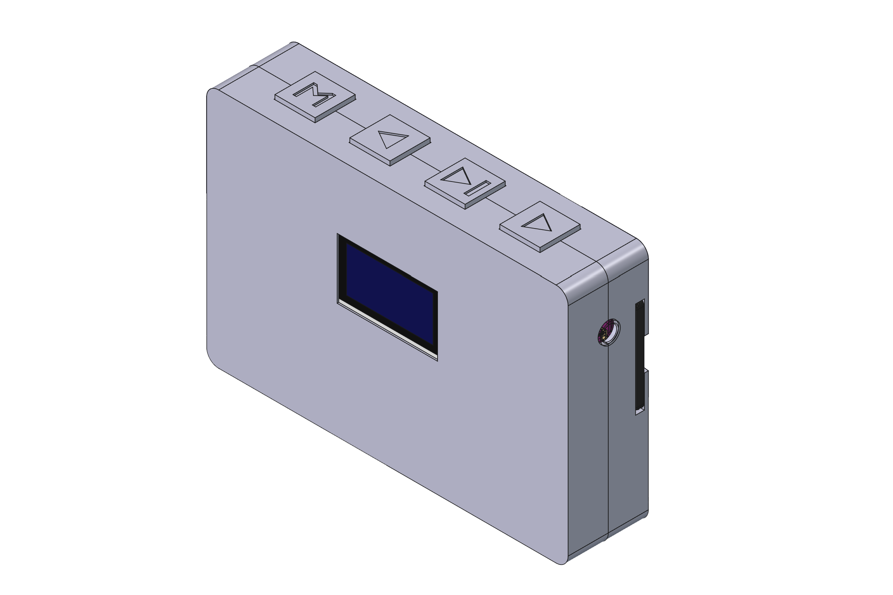
</p>

<p align="center">
  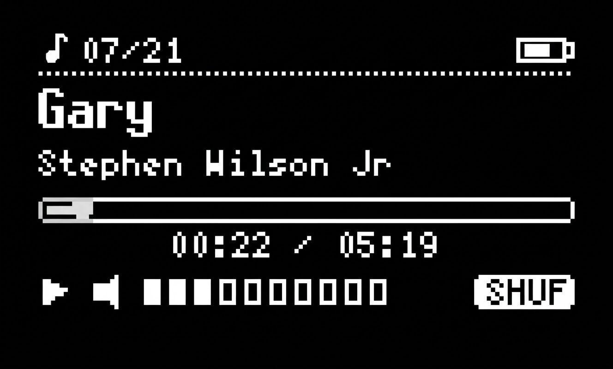
  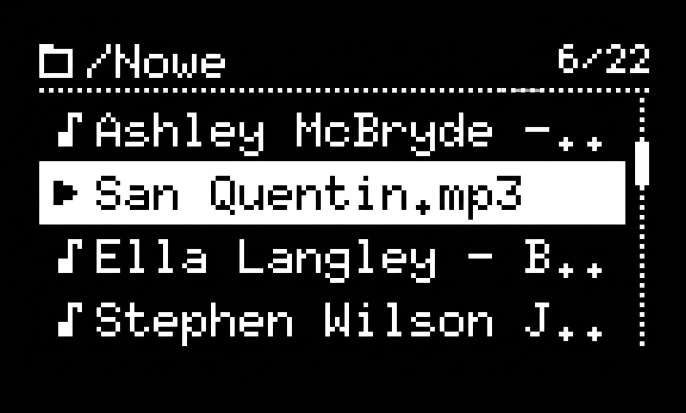
  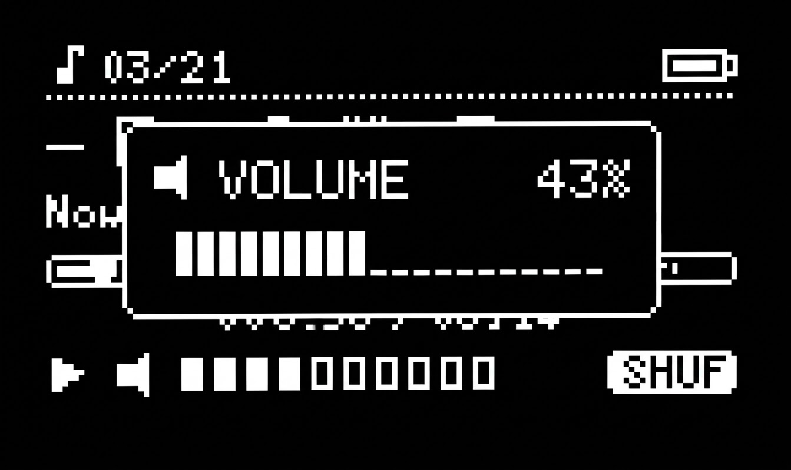
</p>

---

## Contents

- [Features](#features)
- [Bill of materials](#bill-of-materials)
- [Wiring](#wiring)
- [3D-printed case](#3d-printed-case)
- [Assembly](#assembly)
- [Flashing the firmware](#flashing-the-firmware)
- [Usage](#usage)
- [Screens](#screens)
- [Project structure](#project-structure)
- [Known limitations](#known-limitations)

## Features

**Playback**
- MP3 playback from microSD (`BackgroundAudioMP3`, decoding on a dedicated core)
- Playlist = all `.mp3` files in a folder
- Modes: Normal, Shuffle, Repeat One, Repeat All
- Seeking ±10 s, accurate for both CBR and VBR files (Xing/Info TOC, VBRI)
- Real track duration read from the MP3 headers; ID3v2 / ID3v1 title and artist
- Software volume control
- Resume after power-off: last folder, track, position, volume and mode are kept in flash

**OLED interface**
- Now Playing: title and artist with marquee scrolling, progress bar, `01:22 / 04:32` time, play state, volume bar and mode badge
- File browser with folder/track icons, a "now playing" marker, item counter and scrollbar
- Volume and mode-change pop-ups
- Boot splash, "No SD card" and firmware-update screens
- Battery and Wi-Fi client indicators

**Web interface** (Wi-Fi access point, `http://192.168.4.1/`)
- Remote control: play/pause, next/previous, mode, volume, seek
- File manager: browse, upload, download and delete files, create folders
- Wi-Fi settings (SSID / password)
- Firmware update (OTA) from the browser

## Bill of materials

The parts are split into what the firmware needs and what is only needed for the case shown in this repository. You are free to build your own enclosure, perfboard or PCB. Only the **required** group is fixed by the software.

### Required (used by the firmware)

| Qty | Part | Notes |
|---|---|---|
| 1 | ESP32 DevKit V1 (DOIT), 30-pin | 4 MB flash, no PSRAM needed |
| 1 | PCM5102A I2S DAC module | the common purple board with a 3.5 mm line-out jack |
| 1 | SSD1306 OLED 0.96" 128×64, I2C | 4-pin (VCC, GND, SCL, SDA) |
| 1 | microSD socket | an SPI microSD module, **or** an SD→microSD adapter used as a socket (see [below](#using-an-sd-adapter-as-the-card-socket)) |
| 1 | microSD card | FAT32 |
| 4 | Tactile push buttons | NEXT, PREV, PLAY, BROWSER |
| 1 | Switch | Wi-Fi access point on/off |

### Battery power (optional)

| Qty | Part | Notes |
|---|---|---|
| 1 | 18650 Li-ion cell | |
| 1 | TP4056 charger module, USB-C | use the version with battery protection (DW01) |
| 1 | Power switch | between the charger output and the ESP32 |
| 2 | 100 kΩ resistors | ÷2 voltage divider for the battery indicator on GPIO 34 |

Without the divider the player works normally, but the battery indicator shows empty.

### Case hardware (only for the case in this repository)

| Qty | Part | Notes |
|---|---|---|
| 4 | M3 heat-set brass inserts, L = 4 mm | |
| 4 | M3 screws | **L = 15 mm** with a belt clip, **L = 10 mm** without |
| 1 | 2-position DIP switch | switch 1 = power, switch 2 = Wi-Fi |
| 4 | Tactile switches | under the printed button caps |
| 1 | SD→microSD adapter | used as the card socket |

## Wiring

<p align="center">
  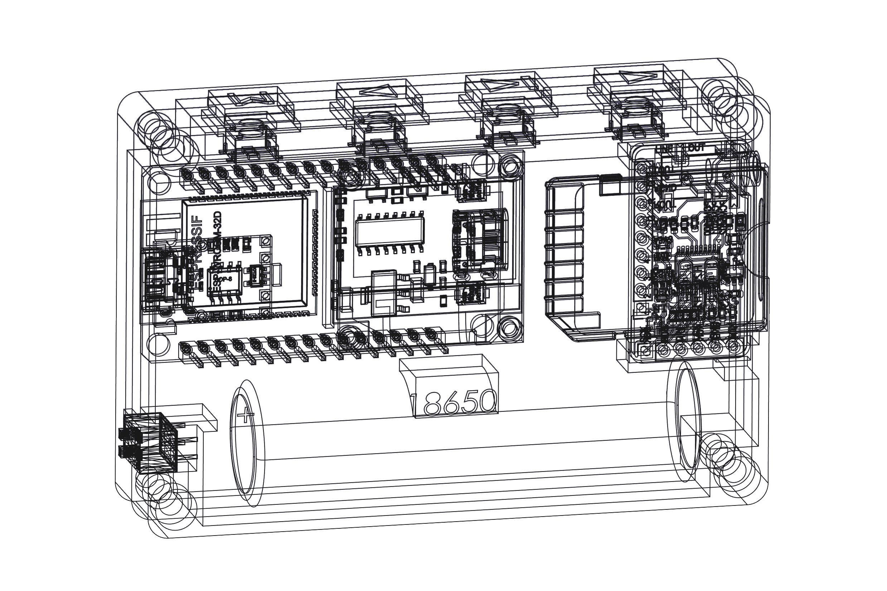
</p>

All pin numbers live in `src/config.h`.

| Module | Module pin | ESP32 |
|---|---|---|
| **PCM5102A** | VIN | 3V3 |
| | GND | GND |
| | BCK | GPIO 26 |
| | LCK (LRC) | GPIO 25 |
| | DIN | GPIO 27 |
| | SCK | GND (internal clock) |
| **OLED SSD1306** | VCC / GND | 3V3 / GND |
| | SDA / SCL | GPIO 21 / GPIO 22 |
| **microSD (SPI)** | CS | GPIO 5 |
| | SCK / MISO / MOSI | GPIO 18 / 19 / 23 |
| | VCC / GND | 3V3 / GND |
| **Buttons** | NEXT | GPIO 4 |
| | PREV | GPIO 33 |
| | PLAY | GPIO 32 |
| | BROWSER (menu) | GPIO 17 |
| **Wi-Fi switch** | | GPIO 16 |
| **Battery divider** | midpoint | GPIO 34 |

- Buttons and the Wi-Fi switch connect the GPIO to **GND**. The firmware enables internal pull-ups, so no resistors are needed.
- On most purple PCM5102A boards the solder jumpers on the back must be set to: **FLT = L, DEMP = L, XSMT = H, FMT = L**. Without XSMT = H the DAC stays muted.
- Battery divider: BAT+ → 100 kΩ → GPIO 34 → 100 kΩ → GND.

### Using an SD adapter as the card socket

A full-size SD→microSD adapter makes a cheap, slim socket. Solder wires directly to its contacts. The card then slides into the adapter through the slot in the case. SD cards run at 3.3 V, so no level shifter is needed.

| Adapter pin | Function | ESP32 |
|---|---|---|
| 1 | CS | GPIO 5 |
| 2 | MOSI (DI) | GPIO 23 |
| 3 | GND | GND |
| 4 | VCC | 3V3 |
| 5 | SCK | GPIO 18 |
| 6 | GND | GND |
| 7 | MISO (DO) | GPIO 19 |
| 8, 9 | not used | |

Pin 1 is next to the chamfered corner of the adapter, and pin 9 sits beside pin 1, behind the chamfer.

### Power

```
USB-C ─► TP4056 ─► 18650
            │ OUT+
            └─► DIP switch 1 (power) ─► ESP32 VIN
```

The ESP32 can also be powered from its own USB port, for example while flashing.

## 3D-printed case

<p align="center">
  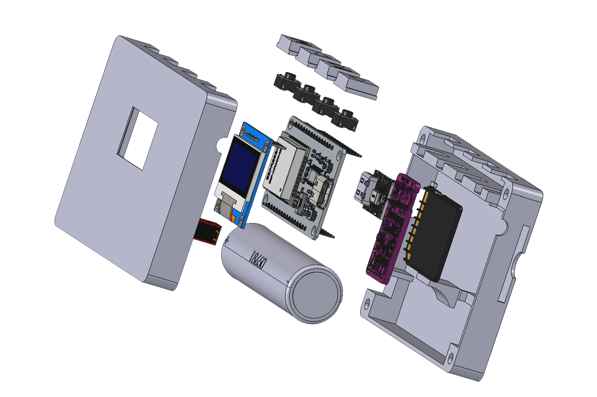
</p>

The STL files are in [`3d_case/`](3d_case):

| File | Part | Qty |
|---|---|---|
| `viStream32_V3-22102026-001-Body.stl` | rear shell, holds the electronics and the battery | 1 |
| `viStream32_V3-22102026-001-Top.stl` | front cover with the display window | 1 |
| `viStream32_V3-22102026-001-Menu*.stl` (4 files) | button caps: menu, previous, play/pause, next | 1 each |
| `viStream32_V3-22102026-001-Clip.stl` | belt clip, **vertical** (optional) | 1 |
| `viStream32_V3-22102026-001-Clip2.stl` | belt clip, **horizontal** (optional) | 1 |

<p align="center">
  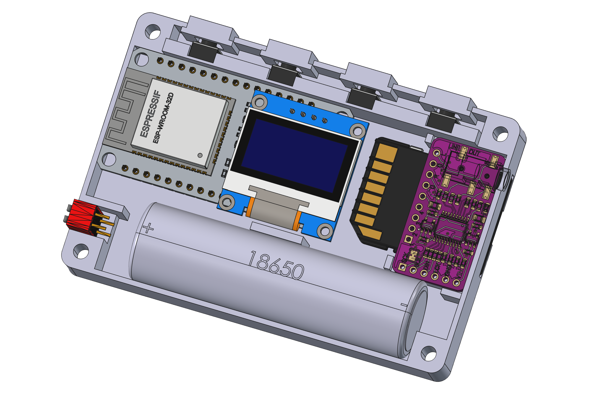
</p>

The case has openings for:
- the 3.5 mm audio jack;
- the microSD slot;
- the DIP switch;
- the charging port.

<table>
  <tr>
    <td align="center">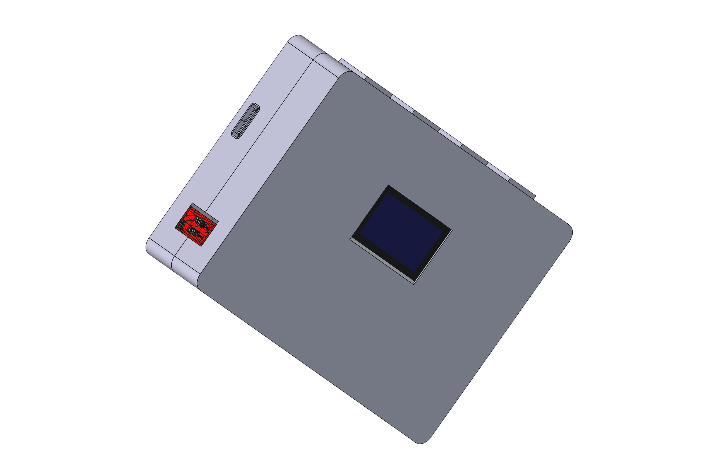<br>Front, DIP switch and USB</td>
    <td align="center">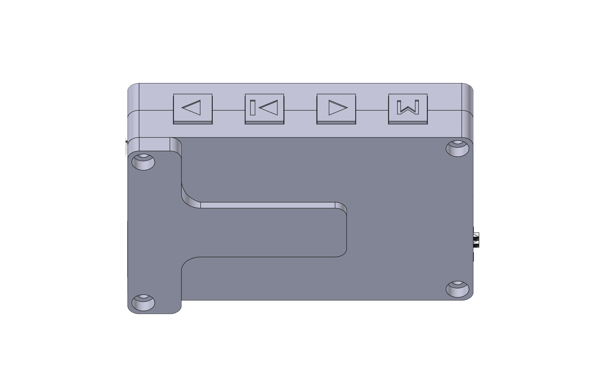<br>Back with clip (option 1)</td>
    <td align="center">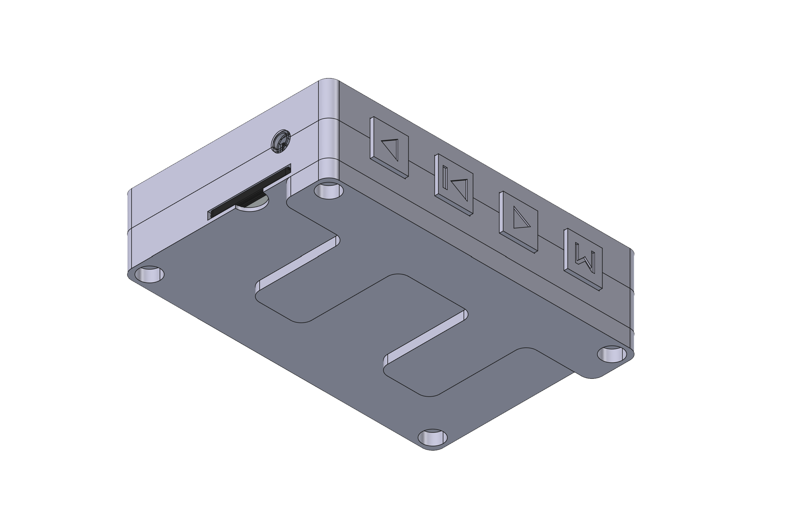<br>Back with clip (option 2)</td>
  </tr>
</table>

## Assembly

1. **Print** the body, the top, the four button caps and, optionally, one clip.
2. **Insert** the four M3 heat-set inserts into the mounting holes with a soldering iron.
3. **Wire** the modules as described in [Wiring](#wiring). Test everything on the bench before closing the case: flash the firmware, insert a card and check sound, display and buttons.
4. **Place** the components as in the render above:
   - the battery along the bottom;
   - the ESP32 and the OLED in the middle;
   - the SD adapter and the PCM5102A on the right;
   - the four tactile switches under the button slots;
   - the DIP switch in the side opening.
5. **Fit** the button caps. The symbols from left to right are: menu, previous, play/pause, next.
6. **Close** the case and fasten it with four M3 screws, through the clip if you use one: 15 mm with a clip, 10 mm without.

## Flashing the firmware

1. Install [PlatformIO](https://platformio.org/) (VS Code extension or CLI).
2. Build and flash over USB:
   ```sh
   pio run -t upload
   pio device monitor        # 115200 baud
   ```
   If the upload fails with "No serial data received", hold the **BOOT** button when `Connecting...` appears.

> The project uses the `min_spiffs.csv` partition table (two 1.9 MB app slots for OTA). The first flash, and any flash after a partition-table change, must be done over USB.

### Updating over Wi-Fi

1. Build with `pio run`. The output is `.pio/build/esp32doit-devkit-v1/firmware.bin`, or use the `.bin` from a GitHub release.
2. Turn the Wi-Fi switch on, connect to the device's access point and open `http://192.168.4.1/`.
3. In **Network → Firmware**, choose the `.bin` file and click **Update**. Progress is shown on the page and on the OLED, and the player restarts when the update is done.

Only `firmware.bin` is used for OTA. `bootloader.bin` and `partitions.bin` are only for USB flashing.

## Usage

### Preparing the card

Format the microSD card as **FAT32** and put the music in folders, for example `/muzyka/`. Each folder is one playlist. On first boot `/muzyka/` is played automatically if it exists; otherwise the file browser opens.

### Controls

| Button | Short press | Long press | Other |
|---|---|---|---|
| NEXT ▷ | next track / move down in browser | seek +10 s | with PLAY held: volume up |
| PREV ◁ | previous track / move up in browser | seek −10 s | with PLAY held: volume down |
| PLAY ▷‖ | play/pause / open selected item | stop | double click: cycle playback mode |
| BROWSER (M) | toggle file browser / Now Playing | | |

### Web remote

Switch Wi-Fi on (DIP switch 2) and connect to the access point:
- **SSID:** `vistream32`
- **Password:** `vistream1234`

Then open `http://192.168.4.1/`. You can change the SSID and password on that page.

## Screens

<table>
  <tr>
    <td align="center"><br>Now Playing</td>
    <td align="center">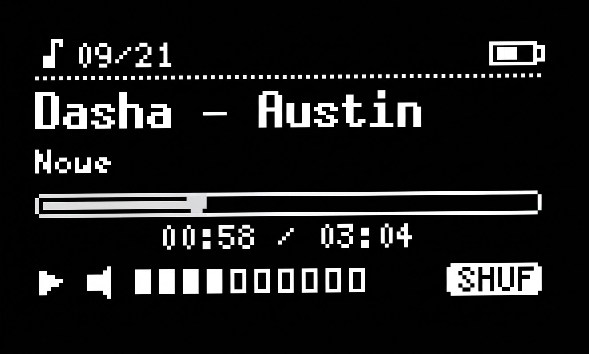<br>Title from the file name, artist = folder</td>
    <td align="center">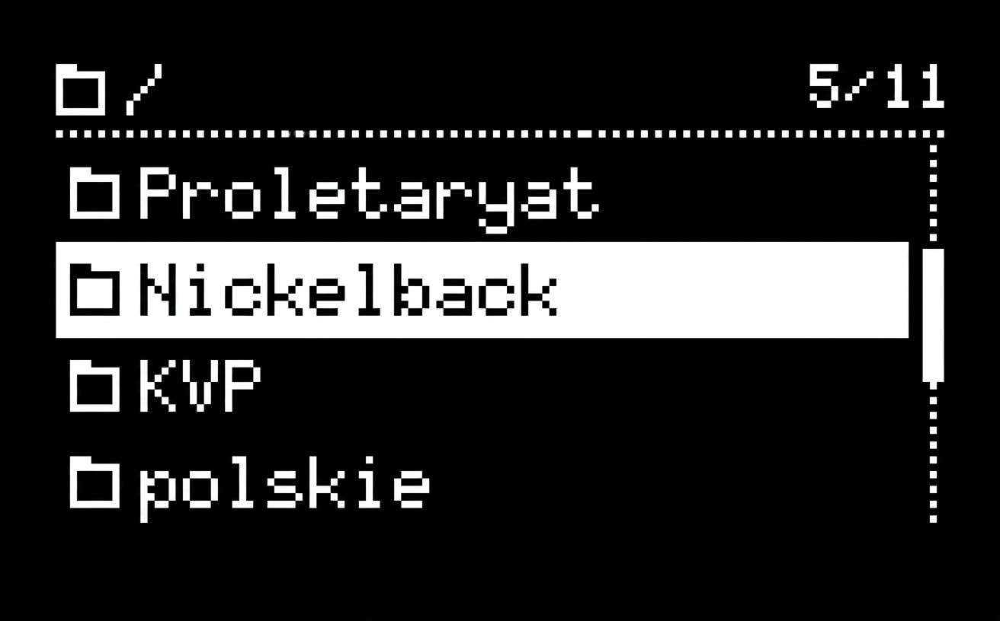<br>Folder browser</td>
  </tr>
  <tr>
    <td align="center"><br>Track browser, ▶ marks the playing track</td>
    <td align="center"><br>Volume pop-up</td>
    <td align="center">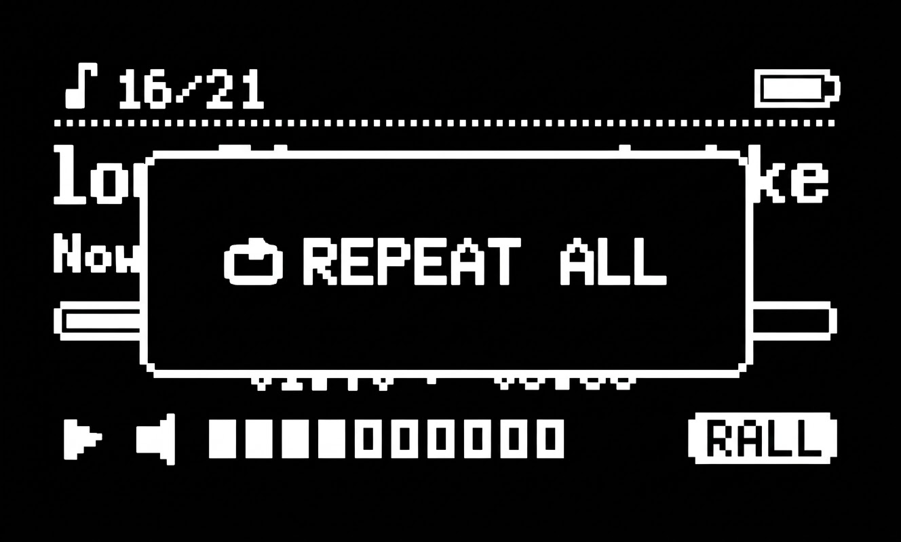<br>Playback-mode pop-up</td>
  </tr>
</table>

## Project structure

```
src/
  main.cpp              setup() order, task creation, loop()
  config.h              pins and tuning constants
  state.h/.cpp          shared state and mutexes
  audio/                player (decoder, playlist, transport), mp3_info (headers, ID3, seeking)
  ui/                   display (OLED screens, uiTask), browser (file navigation)
  input/                buttons
  net/                  wifi_ap, web_server (HTTP routes), ota
  storage/              sd_fs (SD helpers), persistence (NVS)
  power/                battery
  web/index.html        web interface, embedded into the firmware
3d_case/                STL files of the case
images/                 renders and screenshots
```

The firmware runs FreeRTOS tasks on both cores:
- audio feeding on Core 1;
- the OLED UI and the Wi-Fi/web server on Core 0.

See [CLAUDE.md](CLAUDE.md) for architecture notes, the mutex lock order and other implementation details.

## Known limitations

- The OLED fonts are Latin-1 only, so Polish and other non-Latin-1 characters are shown without diacritics on the display. The web page shows them correctly.
- MP3 only.
- The battery reading requires the voltage divider on GPIO 34.

## License

No license has been chosen yet.
